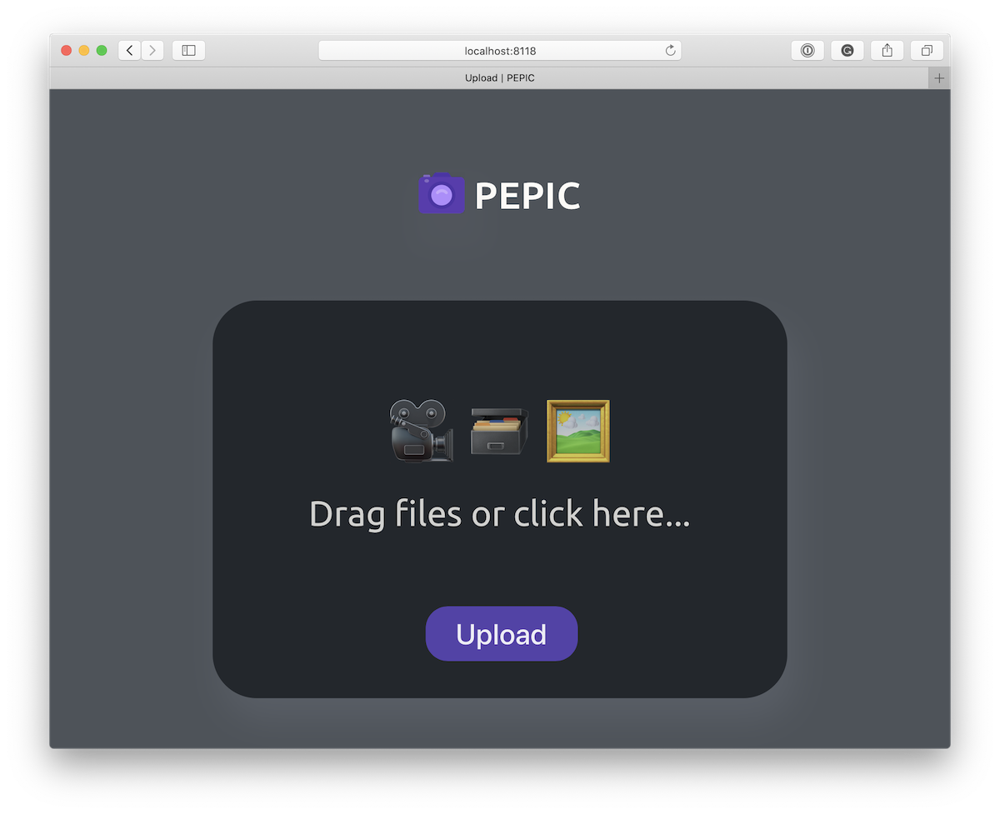

<div align="center">
  <br>
  
  <h1>PEPIC</h1>
</div>

Pepic is a self-hosted image and video upload, storage, conversion, and resizing service. It uses Go, [libvips](https://www.libvips.org/), and [FFmpeg](https://ffmpeg.org/), with local filesystem storage.

Uploads are validated on the backend, including when originals are preserved. Client filenames, extensions, and `Content-Type` headers do not determine whether a file is accepted. Both upload endpoints enforce the same media policy and resource limits.



## Supported files

The default allowlist is defined in [media_defaults.go](pepic/config/media_defaults.go).

| Media | Accepted formats | Default behavior |
| --- | --- | --- |
| Still images | JPEG, PNG, WebP, TIFF, HEIF/HEIC, AVIF | Auto-orient, resize down to the configured longest side, strip metadata, and encode |
| GIF | Static and animated GIF | Convert to MP4 |
| Videos | MP4, QuickTime/MOV, WebM, AVI, Ogg video | Convert to MP4 with H.264/AAC and resize |

Actual decoding and encoding require support in the installed native libraries. The Docker image includes these dependencies. Video containers must contain a decodable video stream; audio-only files, attachment streams, and non-audio/video streams are rejected. Videos with extra metadata/subtitle tracks may therefore need remuxing before upload.

SVG, PDF, archives, installers, executables, and other unlisted formats are rejected. FFmpeg supporting a format does **not** automatically allow it in Pepic. Corrupt media and files exceeding the configured dimensions, duration, or stream limits are also rejected.

Setting `images.store_originals` or `videos.store_originals` to `true` preserves that media's bytes, including its metadata, after validation. Conversion and resizing may change encoded bytes between native library releases. Animated/multipage formats handled by libvips are processed as a still image; use original storage when retaining all frames/pages is required.

## Run locally

Install Go 1.27.2, a C compiler, pkg-config, libvips development headers, and FFmpeg including ffprobe. On macOS:

```sh
brew install go pkg-config vips ffmpeg
git clone https://github.com/vas3k/pepic.git
cd pepic
go run . serve --config ./etc/pepic/config.yml
```

Open [localhost:8118](http://localhost:8118). Run from the repository directory so the HTML and static assets can be found. If macOS reports a pkg-config compiler flag error, set `CGO_CFLAGS_ALLOW=-Xpreprocessor`.

The bundled configuration has no upload secret for local use. Set `SECRET_CODE` before exposing uploads to other users.

## Configuration

Use [etc/pepic/config.yml](etc/pepic/config.yml) as the complete example. Precedence is **module defaults → YAML → environment variables**. Invalid limits and media policies stop startup. Restart after changing configuration.

The normal YAML only needs `global`, `storage`, `images`, `videos`, `canonical_extensions`, and optional `meta` templates. Media and safety defaults live in [media_defaults.go](pepic/config/media_defaults.go) and [safety_defaults.go](pepic/config/safety_defaults.go); they do not need to be copied into YAML.

| Setting | Bundled value | Environment variable | Meaning |
| --- | --- | --- | --- |
| `global.host` / `global.port` | `0.0.0.0` / `8118` | `HOST` / `PORT` | Listen address |
| `global.base_url` | `http://0.0.0.0:8118/` | `BASE_URL` | Public URL; keep the trailing slash |
| `global.secret_code` | empty | `SECRET_CODE` | Shared upload secret; empty allows public uploads |
| `global.max_upload_size` | `50M` | `MAX_UPLOAD_SIZE` | Whole request and per-file/processed-output limit; positive size required |
| `global.file_tree_split_chars` | `3` | `FILE_TREE_SPLIT_CHARS` | Storage path layout; preserve for existing uploads |
| `storage.dir` | `uploads/` | `STORAGE_DIR` | Persistent media directory |
| `images.store_originals` | `false` | `IMAGE_STORE_ORIGINALS` | Preserve image bytes after validation |
| `images.original_length` | `1800` | `IMAGE_ORIGINAL_LENGTH` | Maximum image longest side in pixels; no upscaling |
| `images.auto_convert` | `false` | `IMAGE_AUTO_CONVERT` | Keep format, or use an allowed still-image MIME type |
| `images.live_resize` | `true` | `IMAGE_LIVE_RESIZE` | Generate cached resized images |
| `images.jpeg_quality` | `95` | `IMAGE_JPEG_QUALITY` | Quality for image encoders supporting quality, from 1 to 100 |
| `images.png_compression` | `6` | `IMAGE_PNG_COMPRESSION` | PNG compression 0–9; legacy -1/-2/-3 map to 0/1/9 |
| `images.gif_convert` | `video/mp4` | `IMAGE_GIF_CONVERT` | GIF conversion target; ignored when image originals are preserved |
| `videos.store_originals` | `false` | `VIDEO_STORE_ORIGINALS` | Preserve video bytes after validation |
| `videos.original_length` | `720` | `VIDEO_ORIGINAL_LENGTH` | Maximum video longest side; module fallback is 480 |
| `videos.live_resize` | `false` | `VIDEO_LIVE_RESIZE` | Generate resized videos; otherwise return originals |
| `videos.auto_convert` | `video/mp4` | `VIDEO_AUTO_CONVERT` | Video output MIME type, or `false` to keep its container |

`50M` means 50,000,000 bytes; `MiB` units are also supported. A multipart request's limit includes all files, fields, and framing. Chunked requests are bounded too. Increasing this limit requires reviewing container memory and temporary disk capacity.

`storage.type` is `fs`; only filesystem storage is implemented. Files are named with the SHA-256 hash of the uploaded bytes and the canonical output extension. `canonical_extensions` preserves stable names such as `.jpg` and is also used by MIME/extension validation. Keep these mappings and the storage layout unchanged when upgrading an existing deployment. Legacy configs without the mapping use compatible module defaults.

FFmpeg encoder options are under `videos.ffmpeg`: `temp_dir`, `preset`, `crf`, `buffer_size`, `video_codec`, `video_bitrate`, `video_profile`, `audio_codec`, `audio_bitrate`, `mov_flags`, and `pix_fmt`. Their environment variables use the `VIDEO_FFMPEG_` prefix and uppercase field names. Defaults target MP4/H.264/AAC. If you change the output container or disable conversion, choose compatible encoders and options; allowing WebM input does not make the H.264 encoder suitable for WebM output.

`meta.image_templates`, `meta.video_templates`, and `meta.multi_templates` control copyable snippets in the web interface.

### Media policy overrides

The format table supplies detection, aliases, canonical extensions, processing, frontend accepted MIME types, and download validation. Change the table in one place when adding support. New native image formats also need their decoder/encoder binding in that table.

Optional YAML `media.formats` entries merge into the default table. Setting an entry to `null` removes it. For example, to disallow TIFF:

```yaml
media:
  formats:
    image/tiff: null
```

Removing a format also prevents serving existing files of that type. Keep conversion targets in the allowed table. Changing policy does not scan or delete files already on disk.

### Resource limits

The defaults are:

| Guard | Default |
| --- | --- |
| Concurrent upload/resize jobs | 2; excess work gets HTTP 503 |
| Files per multipart request | 10 |
| Multipart memory before spilling to temporary files | 1 MiB |
| Still-image pixels | 40,000,000 |
| Video/GIF frame pixels | 8,294,400 |
| Maximum width or height | 16,384 pixels |
| Minimum requested resize length | 200 pixels |
| Video duration | 600 seconds |
| Total streams / video streams | 8 / 1 |
| FFprobe / full video decode / transcode deadline | 15 / 30 / 120 seconds |
| FFprobe output | 64 KiB |
| FFmpeg maximum single allocation | 64 MiB |
| Native worker threads per job | 1 |
| libvips cache memory / entries | 32 MiB / 0 |
| HTTP header / read / write / idle timeout | 10 / 120 / 300 / 60 seconds |
| HTTP header size | 32 KiB |

Override specific fields through an optional `safety` mapping when necessary; field names are in [limits.go](pepic/config/limits.go). For example, `safety.max_concurrent_jobs` controls concurrency. These fields have no environment-variable bindings.

FFmpeg uses isolated temporary directories, local-file protocols, and disabled external MOV references. Storage uses confined filesystem access and atomic replacement. Downloads include `nosniff` and restrictive content-security headers.

These guards reduce resource exhaustion risks, but native decoding and its allocations run outside Go's memory manager. A libvips cache limit or FFmpeg single-allocation limit is **not** a process memory limit. Use container/cgroup limits for total memory, CPU, and processes, and cap temporary storage. Image decoding has no separate killable subprocess deadline. Monitor persistent disk space and apply quotas and proxy rate limits: originals and resized variants accumulate on disk.

## HTTP API and resizing

Upload a byte stream:

```sh
curl -H 'Accept: application/json' --data-binary @photo.jpg \
  'http://localhost:8118/upload/bytes/?code=YOUR_SECRET'
```

Upload multipart files:

```sh
curl -H 'Accept: application/json' -F 'code=YOUR_SECRET' \
  -F 'media=@photo.jpg' -F 'media=@clip.mp4' \
  http://localhost:8118/upload/multipart/
```

JSON clients receive HTTP 201 and `{"uploaded":["https://media.example/<hash>.jpg"]}`. Browser uploads redirect to `/meta/<filename>` (comma-separated filenames for batches). A valid secret also sets an HttpOnly, SameSite cookie, marked Secure when the public URL uses HTTPS. Downloads remain public. Avoid logging query strings because the `code` parameter contains the upload secret.

Malformed requests return 400, invalid/missing upload secrets 401, oversized uploads 413, unsupported/corrupt media 415, and exhausted processing capacity 503. Batches are sequential, not transactional: earlier files may remain stored if a later file fails.

- `/<filename>` and `/full/<filename>` serve the stored original.
- `/500/<filename>` generates and caches a version with a longest side of at most 500 pixels.
- When live resizing is disabled for that processor, the original is returned.
- Cached variants are served without taking a processing slot. Missing files return 404.

Keep `images.original_length` consistent with existing URLs: requests at or above that threshold return the original. GIF resizing follows the FFmpeg/video resize setting. Conversion through a URL extension is not implemented.

## Production deployment

Build and test the version you intend to deploy:

```sh
docker build --pull --target test -t pepic-tests .
docker build -t pepic:local .
```

The runtime image runs as UID/GID 1000. Mount a persistent uploads directory writable by that UID, or supply your existing service UID/GID. Back up that directory and your configuration before upgrading.

[docker-compose.example.yml](docker-compose.example.yml) includes a read-only root filesystem, bounded temporary storage, CPU/memory/process limits, dropped capabilities, and a localhost-only published port. To use the published image:

```sh
cp docker-compose.example.yml docker-compose.yml
mkdir -p uploads
export SECRET_CODE='replace-with-a-long-random-secret'
export BASE_URL='https://media.example/'
export PEPIC_UID="$(id -u)"
export PEPIC_GID="$(id -g)"
docker compose pull
docker compose up -d
```

Use a dedicated non-root service account in production. Set `GITHUB_SHA` to a published commit tag to select an immutable release rather than `latest`. For a local build, change the Compose `image` to `pepic:local` and omit `pull`. To override YAML, mount your configuration read-only at `/etc/pepic/config.yml`; environment variables still take precedence.

Terminate HTTPS at your reverse proxy and forward to `127.0.0.1:8118`. Set request-body limits and timeouts consistently with Pepic. For nginx, inside your TLS-enabled server block:

```nginx
client_max_body_size 50m;

location / {
    proxy_pass http://127.0.0.1:8118;
    proxy_set_header Host $host;
    proxy_set_header X-Forwarded-For $proxy_add_x_forwarded_for;
    proxy_set_header X-Forwarded-Proto $scheme;
    proxy_read_timeout 300s;
    proxy_send_timeout 300s;
}
```

Nginx's size units differ from Pepic's decimal `M`; Pepic remains authoritative. Add rate limits at the proxy, and use a dedicated media origin. A CDN can cache public media; do not cache upload responses or authenticated HTML. Preserve upload bodies and byte-range headers through the proxy.

### Upgrade checklist

- Preserve `STORAGE_DIR`, `FILE_TREE_SPLIT_CHARS`, canonical extensions, and the public base URL. Check volume write permissions under the new non-root runtime.
- The bundled upload cap is now **50M**, previously 500M. Existing explicit YAML/environment limits remain effective. Oversized historical originals can still be downloaded, but new resizing is subject to current limits.
- SVG and arbitrary FFmpeg formats are no longer allowed. Audit earlier uploads and remove unwanted files separately; this release does not delete stored data. Purge any unwanted cached files from your CDN too.
- Test representative photos, phone videos, animated GIFs, preserved originals, existing URLs, authentication, and resized URLs with your actual configuration.
- Keep the previous image and configuration for rollback; there is no storage migration. New encoded outputs may differ, and cached variants are not regenerated automatically.
- Review monitoring for 413/415/503 responses, decoder failures, memory pressure, and disk growth before raising limits.

## Tests and security checks

```sh
go test -race ./...
go vet ./...
go run golang.org/x/vuln/cmd/govulncheck@latest ./...
```

Native development dependencies and FFmpeg must be installed to run the full suite. The Docker `test` target provides them. Tests cover direct/multipart upload validation, disguised files, truncation, size/pixel/concurrency limits, real media decoding, conversion, canonical filenames, configuration precedence, storage confinement, authentication, downloads, and resizing.

CI tests pull requests and runs tests plus the Go vulnerability scan before publishing images for pushes to `master`. It publishes both `latest` and commit-SHA tags using `GITHUB_TOKEN`; the repository must have permission to write its GHCR package. No registry personal access token is required.

Go vulnerability scanning does not cover native OS libraries. Scan the final runtime image separately, for example with `trivy image --scanners vuln pepic:local`, and rebuild with updated packages. A clean scan means no known findings in that scanner's database at scan time; it is not proof of no vulnerabilities or protection against malicious content embedded in otherwise valid media. Keep Go, native decoders, OS packages, and the deployment host patched.

## Contributions and license

Report bugs and proposals in [Pepic issues](https://github.com/vas3k/pepic/issues). Upload by URL, cropping, and live format conversion are not implemented.

Alternatives include [imgproxy](https://github.com/imgproxy/imgproxy), [imaginary](https://github.com/h2non/imaginary), and [flyimg](https://github.com/flyimg/flyimg).

Licensed under [MIT](LICENSE). Contact: [me@vas3k.ru](mailto:me@vas3k.ru).
